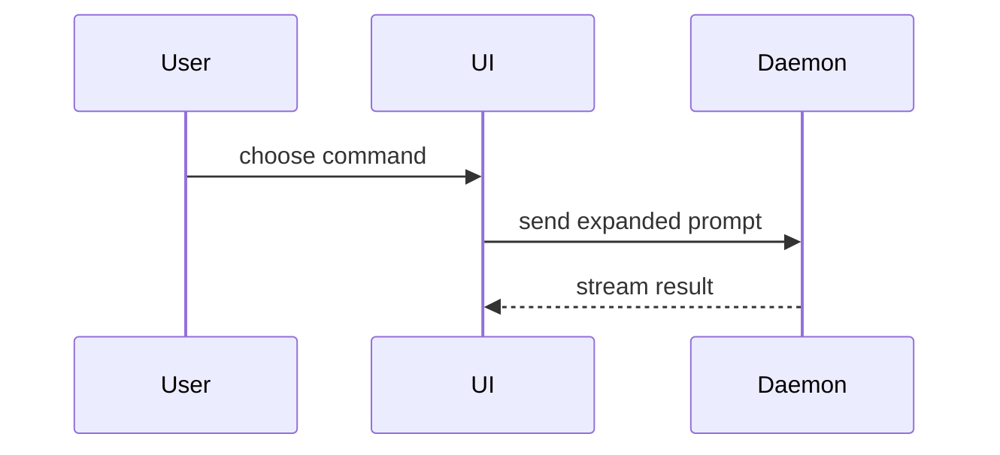

# PR

Creates the PR when the branch has none and updates it when it has one. When asked only for a PR body, run steps 1 to 3 and show the title and body: push nothing and write nothing to GitHub.

## Steps

1. **Find the PR.** `gh pr view --json number,url,state,baseRefName,body` on the current branch. None means create mode, with `main` as the base unless told otherwise. A merged or closed PR: never edit it; say so and stop. An open PR means update mode, with its `baseRefName` as the base.
2. **Read the change.** `git fetch origin <base>`, then `git log origin/<base>..HEAD` and `git diff origin/<base>...HEAD`. Read the spec and plan the change implements, when there are some, and whatever else in the repository the diff needs to make sense.
3. **Write the title and body.** The title is one short imperative sentence, under 70 characters, unless the repository's own rules (AGENTS.md, CLAUDE.md, CONTRIBUTING.md) say otherwise. The body follows the template below. In update mode, start from the current body: rewrite each template section, and keep any section the template doesn't have.
4. **Publish.** Push the branch when it isn't on `origin` yet. Write the body to a file, then `gh pr create --draft --base <base> --title "<title>" --body-file <file>` (without `--draft` when asked for a ready PR), or `gh pr edit <number> --title "<title>" --body-file <file>`.
5. **Answer with the PR's URL.**

## Template

```markdown
## Summary

<diagram, diff-sketch, or tree>

## Evidence

- **Before:** <screenshot/output/failing test run>
  **After:** <screenshot/output/passing test run>

## Merge Danger

**Door:** <one-way or two-way>

<optional: description>

**Blast Radius:** <one-word description>

<optional: potential ramifications of merge>
```

## The sections

Skip all preambles and keep prose brief. Use the repository's domain language (its glossary or `CONTEXT.md`, when it has one).

### Summary

Pick the smallest view that makes the key point clear.

- Show logic or an algorithm as pseudocode:

```text
on(save)
  if content is unchanged
    return cached result
  write new content
  return fresh result
```

- Show runtime control flow as a call tree:

```text
submitForm
  createSession
    persistPrompt
    launchAgent
  navigateToSession
```

- Show UI structure as a component tree, including state and module boundaries that matter:

```text
<SessionPage> (apps/example/src/routes/session.tsx)
  useSessionEvents()
  <SessionToolbar>
    <RunSkillButton> (packages/ui)
```

- Show file responsibility or a broad refactor as a shallow file tree:

```text
src/
├── commands/       # parses user actions
├── sessions/       # owns session state
└── transport/      # sends API requests
```

- Show component interaction, control flow, or data flow with Mermaid:



- Use `diff` when the point is what changes and the surrounding shape already exists. Match the diff shape to the topic.

For a component change:

```diff
 <SessionPage>
   useSessionEvents()
   <SessionToolbar>
+    <RunSkillButton />
   <SessionTimeline>
+    <SkillResultCard />
```

For a file-layout change:

```diff
 src/
 ├── commands/
+│   └── show-me.ts       # expands the slash command
 ├── sessions/
-└── transport.ts
+└── transport/
+    ├── client.ts
+    └── stream.ts
```

For a call-tree or call-stack change:

```diff
 submitForm
   createSession
     persistPrompt
+    expandSkillMention
     launchAgent
-  navigateToSession
+  navigateToSession
+    subscribeToEvents
```

For a state or control-flow change:

```diff
 on(save)
-  write content
+  if content is unchanged
+    return cached result
+  write new content
+  invalidate cache
```

- Show the whole block when most of it is new, when omitted context would hide ownership or order, or when the user needs a copyable target shape:

```ts
function expandSkill(command: string): string {
	const skillName = command.slice(1);
	return `use the ${skillName} skill`;
}
```

#### Guidance

Place each visual next to the short text it supports. Keep only the calls, files, props, states, and boundaries needed to answer the user's current question or the options to resolve the current discussion point.

You may use one of these, you may use several, it is unlikely you will use all of them. Use your judgement and don't overwhelm the user.

### Evidence

Concrete evidence that the change works. Show a before and after.

Screenshots are S-tier - when the environment is set up for it and the change is visual.

Execution-based evidence is A-tier. Test results, console output. Show the exact test that now fails and passes, using pseudocode.

### Merge Danger

Describe whether it's a one-way or two-way door. You can walk back through two-way doors, but not one-way doors. A PR that is cheap to roll back is lower risk. Changes that involve destructive actions or hard-to-reverse decisions are one-way doors.

The blast radius is the potential impact or scope of the changes introduced by this PR. Consider all possibilities. Examples are layout shift, breakages for consumers, mobile responsiveness, etc.
